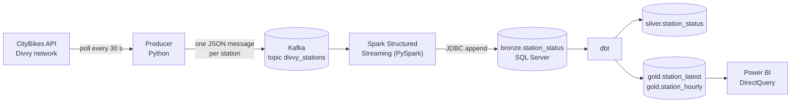

# Divvy Bike Stations: Real-Time Streaming Pipeline

An end-to-end streaming data pipeline that ingests live bike-share station data
for the Divvy network (Chicago) from the [CityBikes API](https://api.citybik.es/v2/networks/divvy),
moves it through Kafka and Spark Structured Streaming into SQL Server, models it
with dbt using a medallion architecture (bronze / silver / gold), and serves a
Power BI dashboard. Everything runs locally with a single `docker compose up`.


## Architecture



| Layer | What it holds |
|---|---|
| **bronze** | Raw snapshots exactly as received. Every pull appends about 2,070 rows (one per station), so a station repeats in every pull. |
| **silver** | Cleaned and de-duplicated. One row per `(station_id, source_timestamp)`, i.e. one row per real station update. Built incrementally. |
| **gold** | Dashboard-ready tables: `station_latest` (current state of each station) and `station_hourly` (hourly averages per station). |


## Tech stack

Python (confluent-kafka, requests), Apache Kafka 3.7 (KRaft, single broker),
PySpark 3.5.1 Structured Streaming, SQL Server 2022, dbt (dbt-sqlserver),
Power BI Desktop, Docker Compose.

## Quick start

Prerequisites: Docker Desktop. Allow Docker about 6 GB of RAM or more.

```bash
git clone https://github.com/<your-user>/divvy-streaming.git
cd divvy-streaming
cp .env.example .env        # Windows: copy .env.example .env
# edit .env and set the four passwords
docker compose up -d --build
```

The first run takes several minutes: images are built, and the Spark container
downloads its Kafka and JDBC connectors once (they are cached in a volume).

Check that everything is running:

```bash
docker compose ps
docker compose logs -f consumer     # look for "Batch N written to bronze.station_status"
docker compose logs -f dbt          # models are rebuilt every 60 seconds
```

Query the data with any SQL client on `localhost,14331` (database
`Bike_Streaming`), for example:

```sql
SELECT TOP 10 * FROM gold.station_latest ORDER BY free_bikes DESC;
```

Stop everything with `docker compose down`. Add `-v` to also delete the data volumes.

### Services

| Service | Role |
|---|---|
| `kafka` | Single-node Kafka broker. Port 9092 for the host, `kafka:29092` inside the Docker network. |
| `kafka-init` | Creates the `divvy_stations` topic, then exits. |
| `producer` | Polls the API every 30 s and publishes one message per station. |
| `sqlserver` | SQL Server 2022 (Developer edition), exposed on host port 14331. |
| `sqlserver-init` | Creates the database, bronze table and the SQL logins, then exits. |
| `consumer` | Spark Structured Streaming job writing micro-batches to `bronze.station_status`. |
| `dbt` | Rebuilds silver and gold every 60 seconds. |

### Configuration

- `.env` (never committed) holds the passwords: `SA_PASSWORD`, `APP_PASSWORD`,
  `DBT_PASSWORD`, `BI_PASSWORD`. Use letters, digits and underscores only.
- `config/config.yaml` holds the API URL, poll interval, Kafka topic and
  default connection settings. Containers override hosts and credentials with
  environment variables (see `docker-compose.yml`).

### Dashboard

`dashboard/divvy_dashboard.pbix` is a Power BI Desktop report using DirectQuery
against `gold.station_latest` and `gold.station_hourly`. Connect it to
`localhost,14331` with the read-only `divvy_bi` login, which can only `SELECT`
from the `gold` schema.

## Design decisions

- **Bronze keeps every snapshot.** The pipeline stays simple and replayable, and
  de-duplication lives in dbt where it is testable.
- **One Kafka message per station, keyed by station id.** Messages are flat
  rows that Spark parses without nested JSON, and updates of the same station
  stay ordered within a partition.
- **Silver grain is a real station update.** Stations that did not change
  between pulls are not stored again. A unique index on
  `(station_id, source_timestamp)` backs the model's logic.
- **Incremental silver.** Only bronze rows newer than the last processed `id`
  are read, because bronze grows by roughly 6 million rows per day.
- **UTC everywhere.** Both the Spark session and the JVM use UTC; the
  dashboard labels its time axis as UTC.
- **Two Kafka listeners.** `localhost:9092` serves tools on the host and
  `kafka:29092` serves other containers, because a broker must advertise an
  address that the client can actually reach.
- **Least-privilege logins.** Spark can read and write the database, dbt owns
  it, and Power BI can only read the gold schema.
- **Rowstore tables in gold.** The default clustered columnstore needs a large
  memory grant and timed out on a memory-constrained machine; gold tables are
  small, so columnstore brings no benefit.

### Data quality notes

- The API returns update timestamps like `2026-10-18T04:32:29.844222+00:00Z`
  (a UTC offset followed by `Z`), which Spark cannot parse. The consumer
  strips the trailing `Z` before converting.
- The API sometimes returns the same update timestamps on consecutive pulls;
  silver de-duplicates them.
- dbt tests cover uniqueness and not-null keys, plus two custom tests: no
  duplicate station updates and valid value ranges in silver.

## Repository layout

```
├── docker-compose.yml
├── config/config.yaml        # API, Kafka and SQL Server settings
├── producer/                 # API -> Kafka (Dockerfile, producer.py)
├── consumer/                 # Kafka -> SQL Server (Spark job, Dockerfile)
├── sql/                      # database, tables and login scripts
├── dbt_divvy_streaming/      # silver and gold models, tests, Dockerfile
├── dashboard/                # Power BI report
└── docs/images/              # screenshots used in this README
```

## Local development (without Docker)

The producer and consumer can also run in a Python virtual environment against
the Dockerized Kafka (`localhost:9092`). On Windows the consumer can write to a
local SQL Server instance with Windows authentication, which needs
`HADOOP_HOME` (winutils) and the `mssql-jdbc_auth` DLL in a `drivers/` folder.
Credentials supplied through environment variables switch it to SQL
authentication, as in Docker.

## Known limitations and roadmap

- [ ] Unit tests and GitHub Actions CI
- [ ] Airflow to orchestrate dbt runs and data-quality checks (a simple loop in
      the `dbt` container is a stopgap)
- [ ] Retention policy for `bronze.station_status`
- [ ] A network-wide time series (total bikes available per hour) using a
      carry-forward over silver
- Delivery from Spark to SQL Server is at-least-once: a retried micro-batch can
  leave duplicate rows in bronze. Silver removes them.
- Single Kafka broker and no authentication: suitable for local use only.

## Author

Yusuf Kamal: [LinkedIn](https://www.linkedin.com/in/your-profile) · [GitHub](https://github.com/your-user)