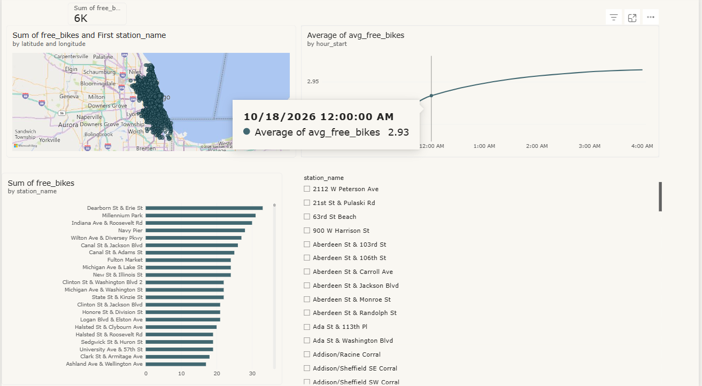
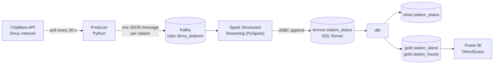
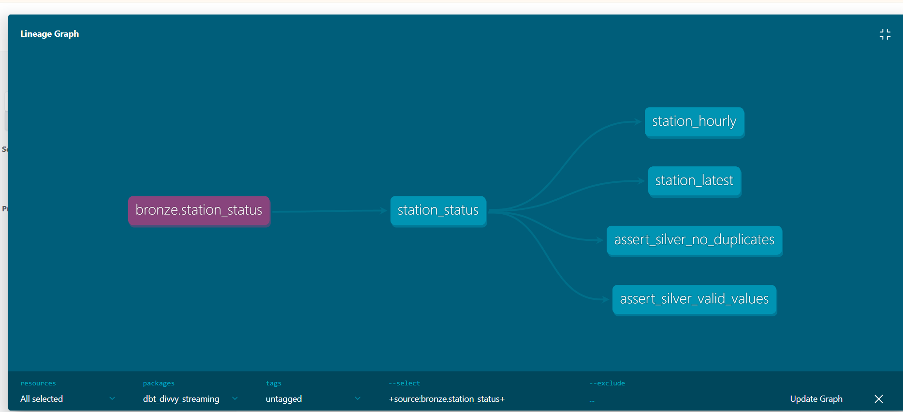

# Divvy Bike Stations: Real-Time Streaming Pipeline

An end-to-end streaming data pipeline that ingests live bike-share station data
for the Divvy network (Chicago) from the [CityBikes API](https://api.citybik.es/v2/networks/divvy),
moves it through Kafka and Spark Structured Streaming into SQL Server, models it
with dbt using a medallion architecture (bronze / silver / gold), and serves a
Power BI dashboard. Everything runs locally with a single `docker compose up`.



## Architecture



| Layer | What it holds |
|---|---|
| **bronze** | Raw snapshots exactly as received. Every pull appends about 2,070 rows (one per station), so a station repeats in every pull. |
| **silver** | Cleaned and de-duplicated. One row per `(station_id, source_timestamp)`, i.e. one row per real station update. Built incrementally. |
| **gold** | Dashboard-ready tables: `station_latest` (current state of each station) and `station_hourly` (hourly averages per station). |



## Tech stack

Python (confluent-kafka, requests), Apache Kafka 3.7 (KRaft, single broker),
PySpark 3.5.1 Structured Streaming, SQL Server 2022, dbt (dbt-sqlserver),
Power BI Desktop, Docker Compose.

## Quick start

Prerequisites: Docker Desktop (allow at least 6 GB of RAM).

```bash
git clone https://github.com/yusuf-kamal/divvy-streaming.git
cd divvy-streaming
cp .env.example .env        # Windows: copy .env.example .env
# edit .env — set the four passwords (letters, digits and _ only)
docker compose up -d --build
```

The first run takes several minutes: images are built, and the Spark container
downloads its Kafka and JDBC connectors once (cached in a named volume).

Check that everything is running:

```bash
docker compose ps
docker compose logs -f consumer     # look for "Batch N written to bronze.station_status"
docker compose logs -f dbt          # models are rebuilt every 60 seconds
```

Query the data with any SQL client on `localhost,14331`
(database `Bike_Streaming`, login `divvy_bi`, password = `BI_PASSWORD` from `.env`):

```sql
SELECT TOP 10 * FROM gold.station_latest ORDER BY free_bikes DESC;
```

Stop everything:

```bash
docker compose down          # keeps data volumes
docker compose down -v       # also deletes all data
```

### Services

| Service | Role |
|---|---|
| `kafka` | Single-node Kafka broker (KRaft). Port `9092` for the host, `kafka:29092` inside the Docker network. |
| `kafka-init` | Creates the `divvy_stations` topic once, then exits. |
| `producer` | Polls the CityBikes API every 30 s and publishes one message per station. |
| `sqlserver` | SQL Server 2022 Developer edition, host port `14331`. |
| `sqlserver-init` | Creates the database, bronze table and all SQL logins, then exits. |
| `consumer` | PySpark Structured Streaming job — reads from Kafka and appends to `bronze.station_status`. |
| `dbt` | Rebuilds silver and gold every 60 seconds. |

### Configuration

| File | Purpose |
|---|---|
| `.env` | Passwords: `SA_PASSWORD`, `APP_PASSWORD`, `DBT_PASSWORD`, `BI_PASSWORD`. Never committed. |
| `.env.example` | Template with placeholder values — committed and safe to share. |
| `config/config.yaml` | API URL, poll interval, Kafka topic, default SQL Server connection. Containers override hosts and credentials with environment variables. |

### Dashboard

Open `dashboard/divvy_dashboard.pbix` in Power BI Desktop and connect it to
`localhost,14331` with the read-only `divvy_bi` login (SQL authentication,
password = `BI_PASSWORD`). The report uses DirectQuery so it reflects the
latest gold tables on every refresh.

Enable **Page refresh** (30 s or 1 min) in Power BI, and run dbt on a schedule
(the `dbt` container does this every 60 s) to see the data update live.

## Running the tests

The unit and integration tests run without Docker:

```bash
pip install -r requirements-dev.txt
pytest -v
```

13 tests cover `to_record`, `publish_snapshot`, `load_config` and the Spark
`parse_stations` function (including the trailing-Z timestamp bug the API
exhibits). They take about 45 s because the Spark tests start a JVM.

The same tests run automatically on every push via GitHub Actions.

## Design decisions

**Bronze keeps every snapshot.**
The pipeline stays simple and replayable. De-duplication and cleaning live in
dbt where they are versioned and testable.

**One Kafka message per station, keyed by station id.**
Messages are flat rows that Spark parses without nested JSON, and updates of the
same station stay ordered within a partition.

**Silver grain is a real station update.**
Stations that did not change between pulls are not stored again. A unique index
on `(station_id, source_timestamp)` backs the model's logic.

**Incremental silver.**
Only bronze rows newer than the last processed `id` are read per run, because
bronze grows by roughly 6 million rows per day.

**UTC everywhere.**
Both the Spark session timezone and the JVM timezone are set to UTC. The
dashboard labels its time axis as UTC.

**Two Kafka listeners.**
`localhost:9092` serves tools on the host; `kafka:29092` serves other
containers. A Kafka broker must advertise an address that the client can
actually reach.

**Least-privilege SQL logins.**
`divvy_app` (Spark) can read and write. `divvy_dbt` owns the database.
`divvy_bi` (Power BI) can only SELECT from the gold schema.

**Rowstore tables in gold (`as_columnstore: false`).**
The default clustered columnstore index requires a large memory grant. Gold
tables hold ~2,000 rows, so columnstore brings no benefit and timed out on this
machine.

### Data quality notes

- The CityBikes API returns timestamps like `2026-10-13T04:32:29+00:00Z` (a UTC
  offset followed by a redundant `Z`). The consumer strips the trailing `Z`
  before parsing; without this fix the column is NULL.
- The API sometimes returns the same `source_timestamp` on consecutive pulls.
  Silver de-duplicates on `(station_id, source_timestamp)`.
- dbt tests enforce uniqueness and not-null on key columns, plus two custom
  singular tests: no duplicate station updates and valid numeric ranges in silver.

## Repository layout

```
divvy-streaming/
├── .env.example                  # password template
├── docker-compose.yml
├── config/config.yaml            # API, Kafka and SQL Server settings
├── producer/                     # API → Kafka  (producer.py, Dockerfile)
├── consumer/                     # Kafka → SQL Server  (spark_consumer.py, Dockerfile)
├── sql/                          # database, table and login scripts
├── dbt_divvy_streaming/          # silver + gold models, tests, Dockerfile
│   ├── models/silver/
│   ├── models/gold/
│   └── tests/
├── tests/                        # pytest unit + Spark integration tests
├── dashboard/divvy_dashboard.pbix
├── docs/images/                  # screenshots used in this README
├── requirements-dev.txt          # dev dependencies (pytest + runtime libs)
└── .github/workflows/ci.yml      # GitHub Actions: tests + compose validation
```

## Local development (without Docker)

The producer and consumer can run in a Python virtual environment against the
Dockerized Kafka (`localhost:9092`).

On Windows the consumer can write to a local SQL Server instance with Windows
Authentication; this requires `HADOOP_HOME` (winutils) and the
`mssql-jdbc_auth` DLL in a `drivers/` folder. Setting `SQLSERVER_USER` and
`SQLSERVER_PASSWORD` as environment variables switches it to SQL authentication
(same as in Docker).

dbt can run locally against the native instance with Windows Authentication
using the `dev` target in `dbt_divvy_streaming/profiles.yml`.

## Known limitations and roadmap

- [x] Unit tests and GitHub Actions CI
- [x] Retention policy for `bronze.station_status` (grows ~6 M rows/day)
- [x] Airflow to orchestrate dbt runs and data-quality checks (the `dbt`
      container loops every 60 s as a stopgap)
- [x] Network-wide time series (total bikes available per hour) using a
      carry-forward over silver
- [x] Power BI connected to the SQL Server container instead of the local
      native instance
- Spark-to-SQL-Server delivery is at-least-once: a retried micro-batch can
  leave duplicate rows in bronze. Silver removes them.
- Single Kafka broker, no authentication: for local use only.

## Author

Yusuf Kamal ·
[LinkedIn](https://www.linkedin.com/in/yusuf-kamal) ·
[GitHub](https://github.com/yusuf-kamal)